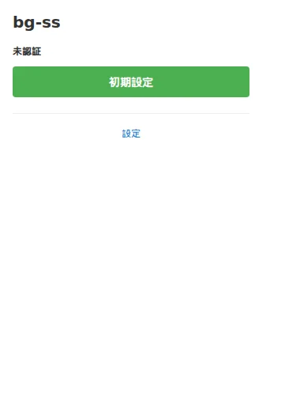

# はじめに

bg-ss は、Windows 専用の Chrome 拡張機能です。スクリーンショットの撮影と、Windows Hello で保護されたテキスト情報（ユーザー名・パスワード等）の管理・自動入力ができます。

## 必要要件

- Windows 10 1809 以降
- Google Chrome 108 以降
- TPM 2.0
- Windows Hello（PIN、指紋、顔認証のいずれか）の設定

macOS / Linux では動作しません。保存したデータはそのデバイスに紐づき、別の PC では使えません。

## インストール

配布版は Chrome Web Store の掲載情報（[store-listing.md](../chrome-store/store-listing.md)）に従ってください。開発版はリポジトリの README「開発版のインストール」（`pnpm install` → `pnpm build` → `chrome://extensions/` で `dist/` を読み込み）に従います。

## 初回設定

1. ツールバーの拡張機能アイコンをクリックして Popup を開く
2. 未認証で「初期設定」ボタンが表示される場合は「初期設定」をクリックする
3. Windows Hello で認証する（初回は認証情報が作成される）
4. 認証が終わるとセッションが始まり、情報管理機能が使えるようになる

Popup には現在の状態が表示されます。

- **未認証**: 「初期設定」（初回のみ）または「認証」ボタン
- **認証済み**: 「認証済み」と残り時間、「ロック」ボタン
- 下部の「設定」リンクから設定（Options）ページを開けます

## 認証とセッション

- 認証は Windows Hello（WebAuthn）で行います。認証情報が失われると、保存済みデータは復号できなくなります。大事な情報は別途バックアップを取ってください
- セッションにはタイムアウトがあり（既定 30 分、設定で変更可）、切れると再認証が必要です
- 「ロック」すると即座にセッションが終わり、再認証が必要になります

## 未撮影の画面

| 画面 | 理由 |
|---|---|
| Windows Hello の認証ダイアログ（PIN・指紋・顔認証） | Windows Hello は Windows 実機でのみ動作する。撮影環境（Linux 上の Chromium）には Windows Hello がなく、認証ダイアログ自体を表示できない |
| Popup の認証済み状態 | 上記の認証を完了できないため、認証済みセッションの画面を撮影できない |
| 初期設定の完了直後の画面 | 同上（認証完了が前提の画面のため） |
