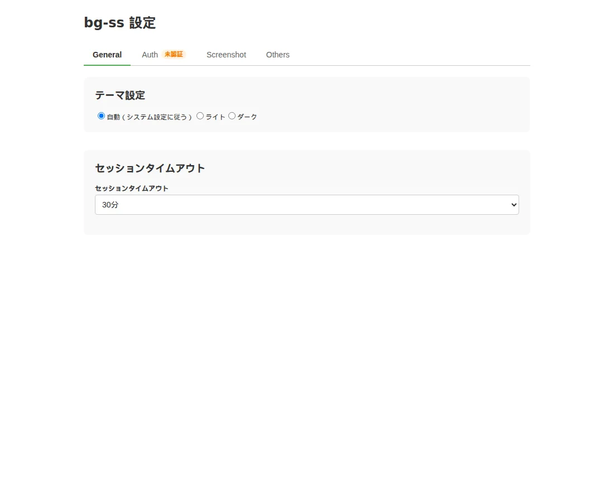
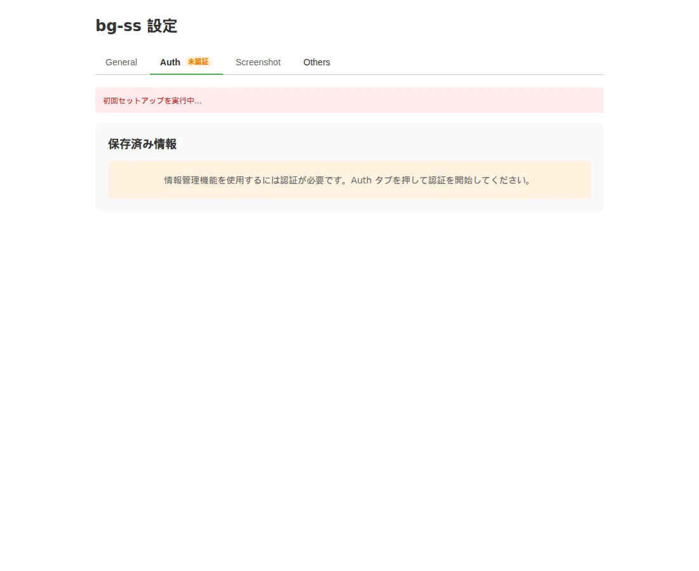
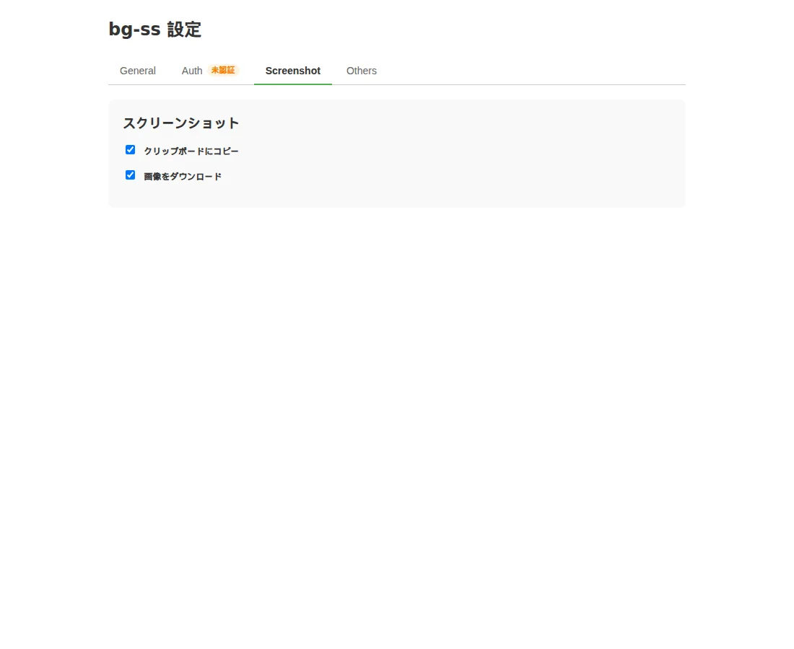
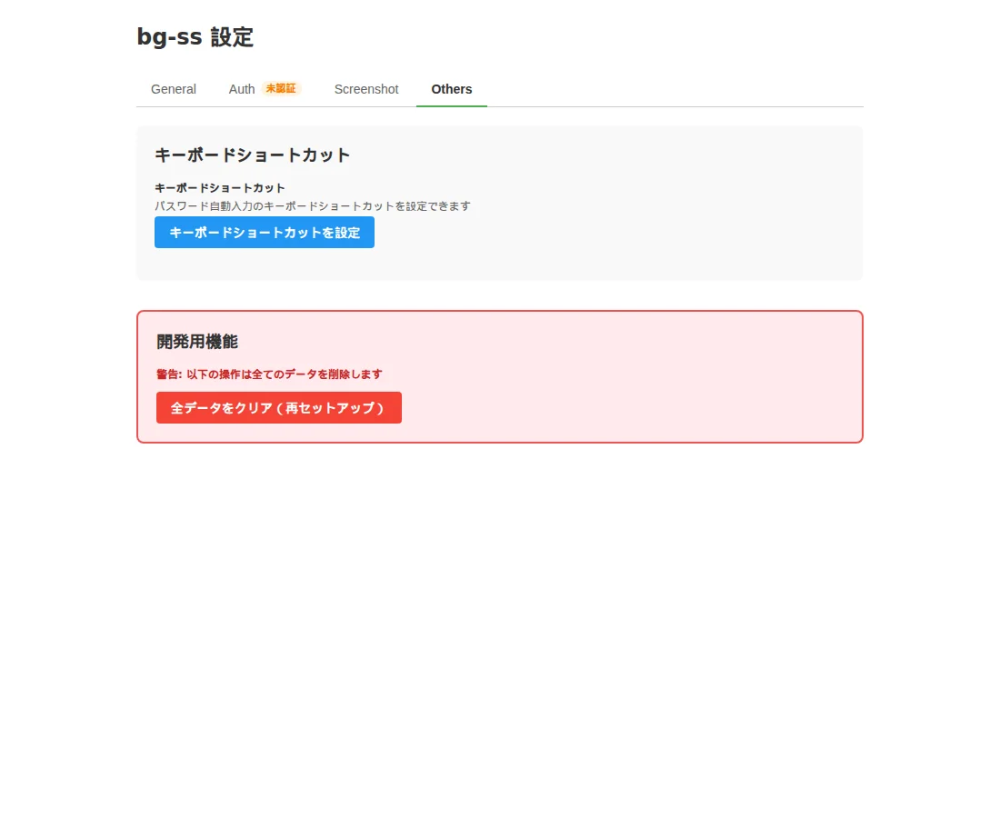

# 設定（Options）

Popup 下部の「設定」リンク、または拡張機能のオプションから開きます。タブは General / Auth / Screenshot / Others の4つです。Auth タブのラベルには認証状態のバッジ（認証済み / 未認証）が付きます。認証済みの間は Auth タブの横に残り時間のリング付きロックボタンが表示され、押すとセッションをロックできます（確認が出ます）。

## General

- **テーマ設定**: `自動（システム設定に従う）` / `ライト` / `ダーク`
- **セッションタイムアウト**: 5分 / 15分 / 30分 / 60分 / 120分（既定は 30分）

変更するとその場で保存されます。

## Auth

保存済み情報の管理画面です。情報管理機能を使うには認証が必要です。未認証の状態では、その旨が表示されます。

認証済みの状態でできること:

- **新規追加**: 「新規追加」ボタンから情報を追加する
  - **タイトル**: 省略可（省略すると URL または現在時刻が自動で入る）
  - **ユーザー名**: 必須
  - **パスワード**: 必須。表示 / 非表示の切り替えと、パスワード生成（文字数、大文字・数字・記号の有無を指定して「生成」）ができる
  - **URL**: 複数登録可、改行区切り。`https://` や末尾の `/` は自動で除去される
  - **追加フィールド**: 「+ フィールドを追加」で、ユーザー名・パスワード以外の項目（電話番号、メールアドレスなど）を追加できる。各フィールドに名前・値・セレクタ（省略可）と `secret`（マスク表示）の指定ができる
- **編集 / 削除**: 一覧の各項目の「編集」「削除」ボタンから。削除時は確認が出る
- **コピー**: ユーザー名・パスワード・追加フィールドの各行のコピーボタンで値をコピーできる。パスワードと `secret` なフィールドは、目のアイコンで表示を切り替えるまでマスクされる
- **セッションをロック**: ロックすると再認証が必要になる

## Screenshot

スクリーンショット撮影時の動作です。両方ともオン / オフできます。

- **クリップボードにコピー**
- **画像をダウンロード**

## Others

- **キーボードショートカット**: 「キーボードショートカットを設定」ボタンで Chrome のショートカット設定画面を開く（割り当て一覧は [usage_autofill-screenshot.md](usage_autofill-screenshot.md)）
- **開発用機能**: 「全データをクリア（再セットアップ）」で全てのデータを削除する。確認が出るが、実行すると取り消せない

## 未撮影の画面

| 画面 | 理由 |
|---|---|
| Auth タブの認証済み状態（保存済み情報の一覧、情報追加 / 編集フォーム） | Windows Hello 認証を完了できない撮影環境（Linux 上の Chromium）のため、認証済みセッションに入れない。認証自体が Windows 実機でのみ動作する |
| セッションロックの確認モーダル（認証済み時のみ表示） | 同上 |
